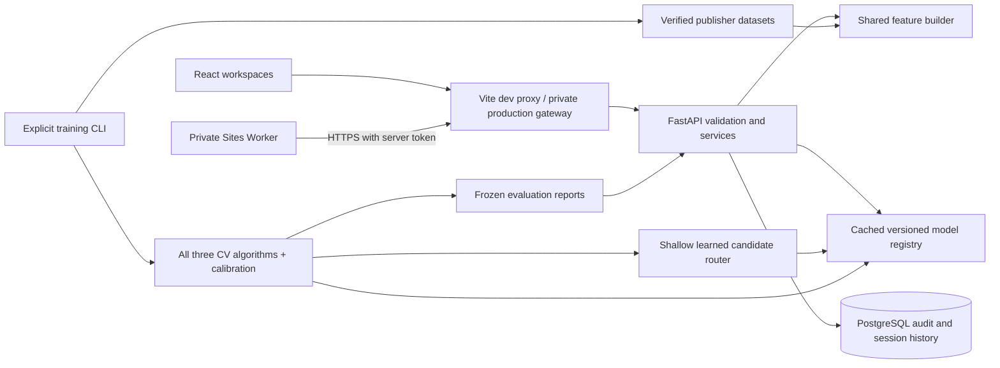

# Architecture and design decisions

The application is a modular monolith. This keeps the laptop version understandable while allowing API workers to scale independently of PostgreSQL.

## Boundaries

- backend/src owns dataset ingestion, feature definitions, temporal partitions, resampling, training, evaluation and inference.
- backend/app owns input contracts, routes, transactions, sessions, reviews, health and access control.
- frontend/src contains the four workspaces and their shared presentation components.
- backend/alembic owns schema changes. Database provisioning is separate; the API role never creates databases.
- scripts owns laptop launch, the interpreter/native-runtime wrapper, the isolated development database and rate-controlled traffic.
- deploy owns cloud/container documentation and a testable Sites server-to-server gateway.

## Data profiles and feature parity

credit_card preserves Time, Amount and V1–V28 at the API boundary, then adds log amount and elapsed-time cycle features inside the shared builder. The source does not provide original PCA inputs, customer identities or interpretable component meanings.

banksim accepts day, customer, merchant, category and amount. It ignores demographic/constant ZIP fields. Features include amount/log amount, strictly previous-seven-day count and mean, ratio to that mean, new merchant/category indicators and the category itself. Customer and merchant IDs are history lookup keys, not high-cardinality classifier inputs.

For each customer's day, earlier-day aggregates and first-seen dates determine features. Same-day observations never contribute to each other's histories. This rule is shared by batch training, single predictions and CSV scoring.

Seeded demo sessions fix a reference-history cutoff on their first prediction. Subsequent changes use that session's committed observations. CSV sessions are unseeded and independent. Because a demo visits selected examples rather than every source transaction, its scores are not used as a new benchmark.

## Model lifecycle and evidence

The fit/calibration/router-training/validation/test windows are disjoint chronological groups, using 40/10/10/20/20 percent of distinct times. Imputation, scaling and resampling learn only from fitting rows. SMOTENC handles BankSim categories before one-hot encoding; plain SMOTE would create invalid fractional categories.

Each of Logistic Regression, Random Forest and XGBoost is trained and calibrated. Non-resampled XGBoost remains a fixed comparison. A multi-output decision tree learns class-balanced squared expert errors on the separate router-training block. It uses features, not expert scores, to select one candidate at serving time. Validation maximizes recall subject to precision >=80% and accuracy >=94%; threshold ties prefer precision, then higher threshold. Auto activates routing only for a strict recall gain over the best eligible individual. Otherwise it explicitly falls back to that individual. Ineligible candidates retain documented manual F1 thresholds; Auto is unavailable if no individual qualifies. Testing reports frozen choices and is explicitly historical, previously inspected evidence.

A run saves immutable candidate files, a report, examples and optional label-free reference history before atomically writing the current pointer. Inference caches requested candidates/controllers per profile per worker and uses one prediction thread per worker to avoid nested CPU pools. Restart workers after a new training run; do not hot-swap only the pointer. Report/model version checks prevent displaying another model's metrics.

Average precision and trapezoidal PR-AUC are both reported and labelled separately. A zero-fraud predictor is the majority baseline. Accuracy goals cannot replace fraud recall/precision. Global permutation importance is computed on validation, not on the test set.

## Request and persistence

1. The API validates finite numeric inputs and the profile/session contract.
2. A PostgreSQL row lock serializes changes to a BankSim session, providing a consistent committed history. Card-data predictions are independent and do not take that lock. Request-specific advisory locks preserve concurrent retry idempotency in both profiles.
3. The service checks the request UUID and payload hash. Exact retries return their stored response. Nondefault model choices participate in the fingerprint; the legacy champion representation is preserved for old retry compatibility.
4. Shared features are built once. The requested manual or Auto policy selects candidates; batch rows are grouped and restored to input order. The frozen policy threshold is applied.
5. Predictions, original inputs, derived features, decision policy and response snapshot commit together.
6. A failed transaction rolls back; no successful response is returned without its audit record.

Batch scoring validates the whole CSV before scoring. It vectorizes prediction and commits all rows with one request snapshot. The request label column goes only to uploaded-data evaluation. Review changes append ReviewEvent records and do not alter source labels or trigger retraining.

Legacy rows retain their IDs and model versions and receive credit_card/open defaults. Their response lineage remains unavailable rather than being invented.

## Operations and deployment

Liveness checks the process; readiness also checks the schema, both model artifacts and matching reports. PostgreSQL determines historical totals; HTTP counters explicitly report only the current worker's scope. Structured request logs include ID, path, status and duration, without transaction payloads.

Development runs Vite, a single API worker and loopback PostgreSQL. Production serves built React assets with Nginx, multiple Python workers and a separate one-shot migration job. Model/report volumes are read-only. Gateway Basic authentication protects the private analyst UI. Token-only /service ingress supports a private Sites Worker without exposing the backend secret to browsers.

The Sites builder embeds the existing Vite assets in a Worker ESM entry compatible with the supported single-file starter. Python, XGBoost and PostgreSQL remain on their container host. No cloud resource is provisioned by the packaging command.

See [router evidence](docs/ROUTER_RESULTS.md) and the [AWS walkthrough](docs/AWS_DEPLOYMENT.md).

## Limits

The present design is for one analyst and isolated research/demo sessions. Public multi-tenant use requires per-user authorization and data ownership. Session histories remain in PostgreSQL; a distributed feature store or queue should only be added after measured load demonstrates a need. The simulator's daily resolution does not justify claims about minute-level account velocity.
